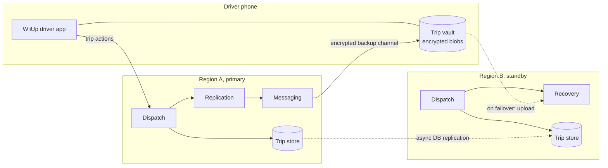
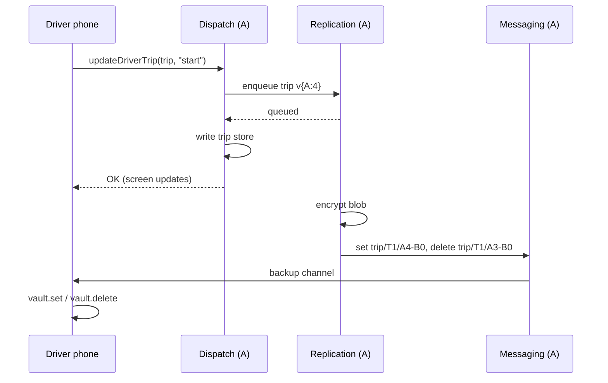

# Region failover with driver phones as backup storage

Status: **phone backups and recovery are built and tested** in `server/` and the app (see
"What is built" below). Running two real regions, and switching traffic between them, is not set up yet.

Based on Uber's design, described in
[Uber Goes Unconventional: Using Driver Phones as a Backup Datacenter](https://highscalability.com/uber-goes-unconventional-using-driver-phones-as-a-backup-dat/).

## The problem

WiiUp runs in two cloud regions:

- **Region A** is the primary, close to Chicago.
- **Region B** is a standby.

Most data can be copied between regions with normal database replication, because a few seconds
of delay doesn't matter. Examples are accounts, plans, Platinum approvals, rate cards and finished
trip history.

**Live trips are different.** A trip changes state every few seconds:

> offered → accepted → arrived → started → completed

If Region A goes down, Region B has to carry on every trip in progress. Without help, it would
only have whatever replication had copied before the outage. Two things could go wrong:

- A trip that was in progress could disappear. The driver would be stuck on a screen the server
  no longer knows about, and the rider would be charged the wrong amount or not at all.
- **WiiUp-specific:** a lost completed trip would make a driver's earnings for the billing
  period too low. Silver drivers are limited to $1,500 and Gold drivers to $3,000 per period, so
  a driver could keep taking rides after their real limit.

Synchronous replication between regions would avoid these losses, but it adds delay to every
trip action, and dispatch would stop if the link between regions failed.

## The idea

Every driver phone keeps an **encrypted, server-written copy of its own trip state**. Region A
sends the copy to the phone in the background after each state change. If Region A fails, the
phone reconnects to Region B. Region B asks the phone what it has and rebuilds the trips from
those copies.

In this design, the phone copy is the authoritative record of the trip. Data flows from the phone
to the server during recovery, never the other way.

**Why driver phones and not rider phones:**

- Driver apps stay open and connected for a whole shift. Rider apps are often backgrounded or
  closed.
- Each trip has exactly one driver.
- The driver app already sends location updates continuously, so it is the best-connected device
  in the system.

## What goes on the phone

Each blob is a JSON trip record that the server encrypts with AES-256-GCM. The phone **cannot
read it or change it**. It only stores the blob and returns it when asked.

### Active trip blob (about 2–4 KB)

| Field | Why it is needed |
|---|---|
| `tripId`, `riderId`, `driverId` | Identity. |
| `tier` (go / comfort / xl / platinum) | Platinum trips must go back to a Platinum driver. |
| `pickup`, `dropoff`, route summary | Lets the trip continue. |
| `quote.fare` | Locked price. The rider pays exactly what they confirmed. |
| `earnings` | Equal to the fare, because the driver keeps 100%. |
| `rateCard` (suggested or custom, with version) | Lets the price be audited later. |
| `stage` and timestamps for each stage | `to_pickup` / `at_pickup` / `in_trip` / `completed`. |
| `cancel` (who and when), `tip` | Final settlement. |
| `version` | Vector clock (see below). |

**Rider details:** only the details the driver can already see (first name and pickup) go into
the blob. The rider's phone number, payment method and full name never do. Encryption protects
the blob anyway, but there is no reason to put that data on a phone at all.

### Completed-trip tombstone (about 100 bytes)

| Field | Why it is needed |
|---|---|
| `tripId` | Identity. |
| `completedAt` | Marks the trip as finished. |
| `earnings` | Feeds the earnings-limit total. |
| `tier` | Trip type. |
| `version` | Vector clock. |

Tombstones are kept for the **driver's whole current billing period**. A period starts on the
`subscribedAt` anchor and runs 31 days or less.

Region B rebuilds the period's earnings total from these tombstones. That keeps Silver and Gold
limits and Gold Plus upgrades correct after a failover. Even at 600 trips in one period, the
tombstones come to about 60 KB.

**Phone storage limit: 256 KB per driver.** If the limit is reached, the phone keeps the newest
tombstones and reports that it dropped older ones. Region B then uses the replicated database for
anything older.

## Phone protocol

The phone stores blobs in a simple key-value store. It has four operations, all sent by the
server over a dedicated channel:

| Operation | Effect |
|---|---|
| `set(key, blob)` | Store a blob. **Write-once**: if the key already exists, nothing happens. |
| `get(key)` | Return a blob. |
| `delete(key)` | Remove a blob. |
| `list()` | Return all stored keys. |

**Keys** look like `trip/<tripId>/<versionTag>`. The version is part of the key, so an update
is two steps:

1. `set` the new version.
2. `delete` the old version.

If something fails between the two steps, the phone has two versions, never zero. Recovery picks
the newest one. Because keys are write-once, a message that arrives late or twice can't overwrite
newer data.

**Versions** are a vector clock with one counter per region, for example `{A: 7, B: 0}`. Each
region bumps only its own counter when it changes a trip. Two cases come out of this:

- One copy is ahead of the other in every counter. That copy wins.
- Neither copy is ahead. The two regions changed the same trip independently, which can happen
  during a split. That is a conflict, resolved by the rules under Reconciliation.

**The backup channel is separate from trip actions.** A backup can be late, but it never slows
down "Accept" or "Complete trip". If the phone goes offline, the server queues backups and sends
the latest version when the phone reconnects.

## Normal operation (Region A healthy)

The phone gets its OK **before** the backup is written. Backups are eventually consistent and
never block a trip action.

## Failover (Region A down)

1. **Detection.** Health checks fail, and an on-call engineer or an automatic rule moves traffic
   to Region B through DNS or a global load balancer. Phones then reconnect to Region B.
2. **Phone reconnects.** On its first request, Region B sees that the driver has no live session.
   It answers with `recover` and pauses new ride offers to this driver until recovery finishes.
3. **Inventory.** Region B calls `list()`. It compares the keys on the phone with the trips it
   knows for this driver from the replicated database, then calls `get()` for every key that is
   missing or newer.
4. **Restore.** Region B decrypts each blob and checks its authentication tag. A blob that fails
   the check is rejected and logged as possible tampering. Region B then reconciles with what it
   has (see below) and writes the result to its trip store.
5. **Resume.**
   - The driver's trip screen continues where it was.
   - Offers resume if the driver is under their plan limit, which Region B calculates from the
     tombstones.
   - The rider app reconnects through `subscribeRide` and receives the restored trip.

**What the driver sees:** a banner, *"Reconnecting… your trip is safe"*, for a few seconds.
Nothing else changes.

### Rider whose driver is offline during failover

The trip can't be restored until the driver's phone reconnects. Region B handles this as
follows:

- It shows the rider "Finding your trip…".
- If the driver doesn't reconnect within 2 minutes, it falls back to the last trip state in the
  replicated database.
- If that state is pre-pickup, it offers the rider a free rebook.
- If that state is mid-trip, it holds settlement until the driver phone uploads.

## Reconciliation rules

| Situation | Outcome |
|---|---|
| Only the phone has the trip | Restore from the phone. |
| The phone's version is newer | Restore from the phone. |
| The database's version is newer | Keep the database version. This is rare and means the phone missed a backup. |
| Conflict: neither version is newer | Keep the later stage (`completed` > `in_trip` > `at_pickup` > `to_pickup`). A cancel beats a non-completed stage. Flag the trip for admin review. |
| The phone has a tombstone and the database shows the trip as active | Mark the trip completed. This prevents the trip being dispatched again or the driver being double-booked. |
| The blob fails decryption or the tag check | Reject it, use the database version, and alert security. |

## Failback (Region A returns)

Region A comes back with stale trips. Before it takes traffic again:

1. Region A catches up from Region B through database replication.
2. Phones that move back to Region A go through the same `list()` and `get()` recovery. Any trip
   that ended while Region B was in charge appears on the phone as a tombstone. Region A therefore
   learns that the trip ended and never tries to re-dispatch it.
3. Each region only bumps its own counter in the vector clock, so a version written by Region B
   is never mistaken for an older Region A version.

No manual cleanup scripts are needed in either direction.

## What is **not** recovered from phones

The phone is authoritative for **trip state only**. Money and approvals have their own source of
truth:

| Data | Source of truth during failover |
|---|---|
| **Instant payouts** | The payment ledger, with synchronous cross-region writes or the payment provider's own records. Instant payout is **paused** until Region B confirms that the ledger is current. The driver sees "Instant payout is paused for a few minutes." A payout is never rebuilt from a phone. |
| **Subscription charges and upgrades** (Silver, Gold, Gold Plus, Platinum) | The billing provider. Charges use idempotency keys, so retries never charge twice. |
| **Rider charges** | Charged once, at completion, with idempotency key `tripId + completed`. A restored trip that was already charged isn't charged again. |
| **Platinum approvals, background checks, admin actions** | The replicated database. These change slowly, and a few seconds of delay is fine. |
| **Rate cards** | The replicated database. Each trip blob carries the rate card it used, so prices for trips in progress stay fixed. |

## Security

- **Encryption keys.** Blobs are encrypted with keys that the server holds in a key management
  service and that both regions can use. Keys are rotated monthly, and each blob records its key
  ID so older blobs can still be read.
- **What the phone holds.** The phone never has the key. A driver who edits a blob, for example to
  raise their earnings, fails the authentication check, and the blob is rejected.
- **Replay.** A driver can't replay an old blob to undo a completed trip. Tombstones and the
  reconciliation rules mean an older version never replaces a newer one, and replayed keys are
  write-once.
- **Storage on the device.** The vault is an app-private file, written with
  `expo-file-system`. It doesn't need Keychain-level storage because its contents are already
  encrypted.
- **Sign-out.** Signing out of driver mode clears the vault, but only after the server confirms
  it has no active trips for that driver.

## Proving it works

Region failures are rare, so this needs continuous testing rather than waiting for a real outage.

- **Hourly audit.** For every online driver, compare what Dispatch has with what the phone's vault
  holds, through a `list()` sent over the backup channel. Report coverage by city and app version:
  the percentage of active trips whose latest version is on the phone.
- **Shadow restore.** Send the audited phone data to Region B's recovery service in dry-run mode.
  Measure how many trips restore successfully and how long a full-fleet recovery would take. Don't
  write any of it.
- **Game days.** Fail over a test city, or a set of internal test drivers, to Region B on a
  schedule. Do this before launch and then every quarter.
- **Targets before launch** (to be agreed):

  | Measure | Target |
  |---|---|
  | Active trips with the latest version on the phone | 99.9% or more |
  | Backup lag (95th percentile) | Under 5 seconds |
  | Shadow restores that succeed | 99.99% |

## What is built

| Piece | Where |
|---|---|
| Sealing, version clocks, writing backups, recovery, conflicts, audit | `server/src/backup.ts` |
| A new version for every saved trip change | `persistTrip` in `server/src/dispatch.ts`. Trips have a `version` column in SQLite. |
| Backup channel | The existing live socket. The server sends `{type:"vault", op:"set"/"delete"/"list"/"get"}`, and the phone answers `vault_keys` and `vault_blob`. |
| Phone vault | `src/store/useTripVault.ts`, saved with AsyncStorage. Keys are write-once, with a 256 KB cap. `src/api/http.ts` answers the server's requests. |
| Recovery handshake | Runs each time an app connects. Offers wait until it finishes. Trip actions on a trip the server hasn't restored yet get `503 recovering`, and the app retries for up to 8 seconds. A rider following a ride the server doesn't know yet keeps asking every 2 seconds. |
| Paused payouts | After any restore, `POST /v1/driver/payouts` returns `payouts_paused` until an admin calls `POST /v1/admin/failover/confirm-ledger`. The payout screen shows the reason. |
| Admin | `GET /v1/admin/failover/events` lists restored, conflict and rejected events, and `GET /v1/admin/backup/audit` gives on-demand coverage of trips in progress. |
| Settings | `WIIUP_REGION` (A, B, …) and `WIIUP_BACKUP_KEYS` (`id:base64key,…`, newest first, the same in every region). |
| Tests | `server/test/failover.test.ts`. Region B starts from a stale database copy on the same address. It rebuilds a trip in progress and a finished trip from the phone, the rider's app finds the ride again, and earnings include the restored tombstone. It also tests a tampered backup being rejected and a conflict between regions. |

**Differences from the design above:**

- The vault uses AsyncStorage (already in the app) rather than `expo-file-system`. The blobs are
  sealed either way.
- The vault is not cleared on sign-out. Keys include the driver ID, so the server ignores backups
  that belong to another driver.

**Not built yet:**

- The rider's 2-minute fallback and free rebook when the driver stays offline.
- Shadow restore, and running the audit on a schedule.
- The **Failover** tab in `admin/`.
- The "Reconnecting…" banner in the driver app.
- Deploying two regions with replication and traffic switching between them.

## Rollout

1. **Done:** the vault, the backup channel, recovery and the tests listed above, built against the
   real server rather than the mock.
2. **Backend, audit only.** Write backups to phones and run the hourly audit and shadow restore.
   There is no real failover yet. Watch coverage by app version.
3. **Game days** with internal drivers in Chicago.
4. **Live.** Automatic failover is enabled for Chicago.

## Open questions

- Cloud provider and the two regions to use.
- Should failover be automatic or need an engineer's approval? The suggestion is manual at first.
- The rider-side timeout when the driver is offline. Is 2 minutes, then a free rebook if before
  pickup, the right policy?
- Should rider phones also keep a copy, as a second source for trips whose driver stays offline?
- The real limits and targets above are placeholders, like the payout fee and limits.
